# System Sequence Diagrams
## Increment 1: Foundation & The Farmer Dashboard

| Field               | Value                                                              |
|---------------------|---------------------------------------------------------------------|
| **Project Name**    | Agri-Grid: Smart Agriculture & Food Security Ecosystem              |
| **Document ID**     | `AG-SSD-INC1-002`                                                   |
| **Version**         | 1.1                                                                 |
| **Prepared By**     | Requirements & Architecture Agent (Lead Software Architect)         |
| **Reviewed By**     | Ameer Muawiyah (Project Manager & Lead Data Architect) — CTO Review |
| **Date**            | 2026-10-11                                                          |
| **Source Document** | `AG-SRS-INC1-001 v1.1` — `./Architecture_Blueprints/Increment_1/1_Farmer_Dashboard_SRS.md` |

> **v1.1 Change Summary:** Fixed UML fall-through anti-patterns (all `alt` blocks now use `alt...else...end`). Optimized login to single LEFT JOIN query. Added `COUNT(*)` companion query for pagination. Split Flow 2B into three isolated sub-flows. Declared all participants at diagram top. Added four new diagrams covering the missing 75% of Crop CRUD: READ (List), READ (Single Detail), UPDATE, and WITHDRAW (Soft-Delete).

---

## Table of Contents

1. [Diagram 1 — RBAC Login & Authentication Flow](#diagram-1--rbac-login--authentication-flow)
   - [1A — Farmer Registration (Atomic Transaction)](#1a--farmer-registration-atomic-transaction)
   - [1B — Farmer Login & JWT Issuance](#1b--farmer-login--jwt-issuance)
   - [1C — Protected Route Guard (JWT Middleware)](#1c--protected-route-guard-jwt-middleware)
2. [Diagram 2 — Active Crop CREATE](#diagram-2--active-crop-create)
   - [2A — Happy Path: Successful Crop Creation](#2a--happy-path-successful-crop-creation)
   - [2B-1 — Role & RBAC Rejection](#2b-1--role--rbac-rejection)
   - [2B-2 — Input & Temporal Validation Cascade](#2b-2--input--temporal-validation-cascade)
   - [2B-3 — DB Write Failure & Rollback](#2b-3--db-write-failure--rollback)
3. [Diagram 3 — Active Crop READ (Paginated List)](#diagram-3--active-crop-read-paginated-list)
4. [Diagram 4 — Active Crop READ (Single Detail)](#diagram-4--active-crop-read-single-detail)
   - [4A — Happy Path: Single Listing Retrieved](#4a--happy-path-single-listing-retrieved)
   - [4B — Security Check: Unified 404 Response](#4b--security-check-unified-404-response)
5. [Diagram 5 — Active Crop UPDATE](#diagram-5--active-crop-update)
6. [Diagram 6 — Active Crop WITHDRAW (Soft-Delete)](#diagram-6--active-crop-withdraw-soft-delete)
7. [Participant Legend](#participant-legend)
8. [SRS Requirement Traceability](#srs-requirement-traceability)
9. [Revision History](#revision-history)

---

## Diagram 1 — RBAC Login & Authentication Flow

> **SRS Reference:** FR-LGN-001 through FR-LGN-024, §3.3 JWT Contract, §6.1 Route-Level Access Control, §6.3 RBAC Violation Responses.

---

### 1A — Farmer Registration (Atomic Transaction)

> **Key SRS Rules:** `FR-LGN-017` (empty field rejection) · `FR-LGN-018` (`farm_name` required for farmers) · `FR-LGN-018A` (atomic `Users` + `Farmers` transaction) · `FR-LGN-019` (role whitelist) · `FR-LGN-020` (unique username) · `FR-LGN-021` + `NFR-SEC-001` (bcrypt hashing) · `§8.2` (registration error table)
>
> **v1.1 Fix:** Replaced standalone `alt...end` fall-through blocks with fully nested `alt...else...end` structure. Error branches now visually terminate execution — the happy path only proceeds through the final `else` clause.

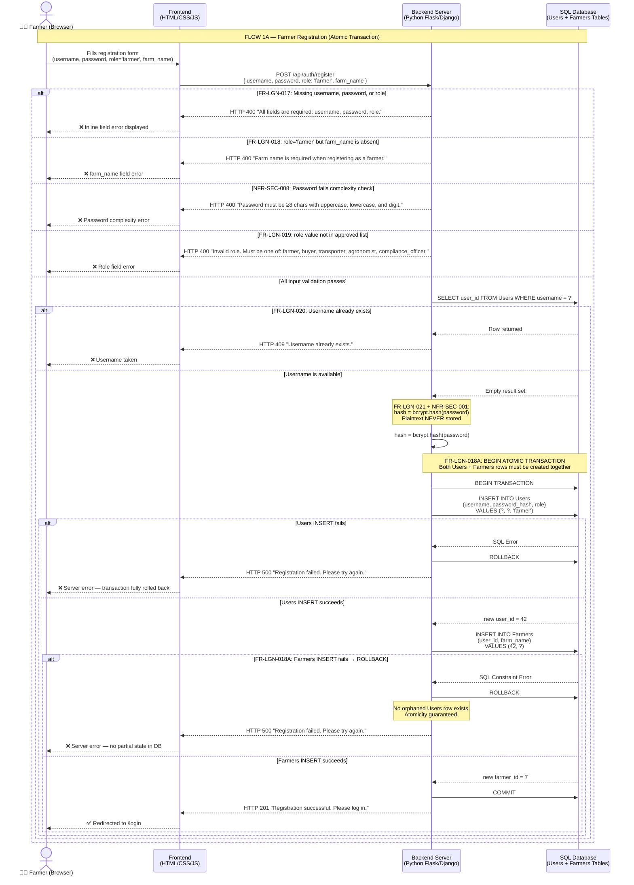

---

### 1B — Farmer Login & JWT Issuance

> **Key SRS Rules:** `FR-LGN-004`–`FR-LGN-008` (credential submission & DB check) · `FR-LGN-009` (HS256 JWT with `user_id`, `farmer_id`, `role`, `exp`) · `FR-LGN-010` (response schema) · `FR-LGN-011` (`sessionStorage` storage) · `FR-LGN-012` (role-based redirect) · `FR-LGN-014`–`FR-LGN-016` (generic error, no enumeration) · `§3.3` JWT Contract · `NFR-PERF-001`
>
> **v1.1 Fixes:** (1) Replaced two sequential DB queries (`SELECT Users` then `SELECT Farmers`) with a single optimized `LEFT JOIN` query — halving DB round-trips to meet `NFR-PERF-001` (p95 < 1s @ 50 concurrent users). (2) Fixed fall-through `alt` blocks to proper `alt...else...end`.

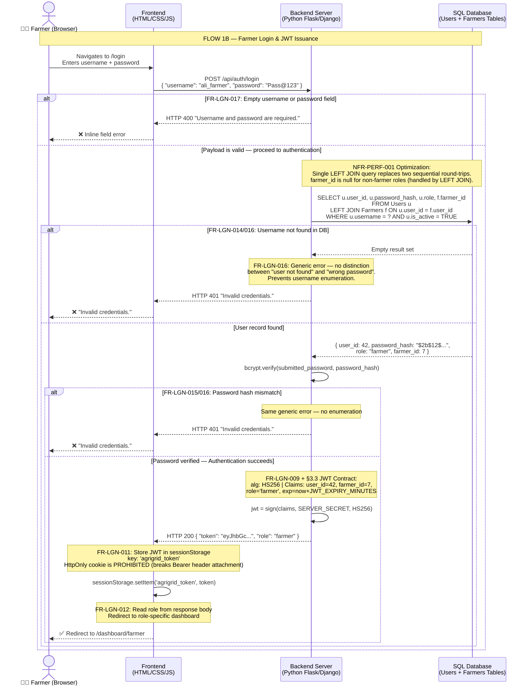

---

### 1C — Protected Route Guard (JWT Middleware)

> **Key SRS Rules:** `FR-LGN-011` (sessionStorage retrieval) · `FR-LGN-022` (Bearer header + signature/expiry validation) · `FR-LGN-023` (401 on invalid/missing JWT) · `FR-LGN-013` (farmer dashboard only functional in Inc 1) · `NFR-SEC-002` (all protected endpoints require JWT) · `NFR-SEC-003` (JWT expiry) · `§6.1` (Route Matrix) · `§6.3` (violation responses) · `FR-CRP-011` (paginated response with `total`)
>
> **v1.1 Fixes:** (1) Fixed fall-through `alt` blocks. (2) Added explicit `COUNT(*)` companion query so the backend agent implements the `total` field mandated by `FR-CRP-011`.

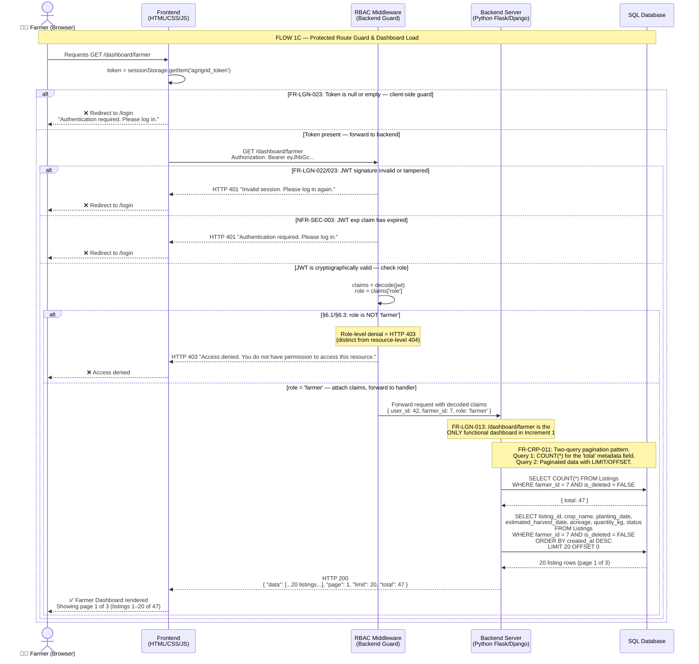

---

## Diagram 2 — Active Crop CREATE

> **SRS Reference:** FR-CRP-001 through FR-CRP-009, FR-CRP-004A, FR-CRP-005, FR-CRP-006A, §3.3, §6.1, §6.2, §6.3, §8.3.

---

### 2A — Happy Path: Successful Crop Creation

> **Key SRS Rules:** `FR-CRP-001`–`FR-CRP-003` (UI → `POST /api/crops`) · `FR-CRP-004` (strict JSON payload) · `FR-CRP-004A` (taxonomy whitelist) · `FR-CRP-005` (`farmer_id` from JWT only) · `FR-CRP-006` (SQL INSERT) · `FR-CRP-006A` (temporal validation) · `FR-CRP-007`–`FR-CRP-009` (HTTP 201, success notification, `status` auto-set) · `NFR-SEC-004` (Zero-Trust) · `NFR-REL-001` (ACID INSERT)

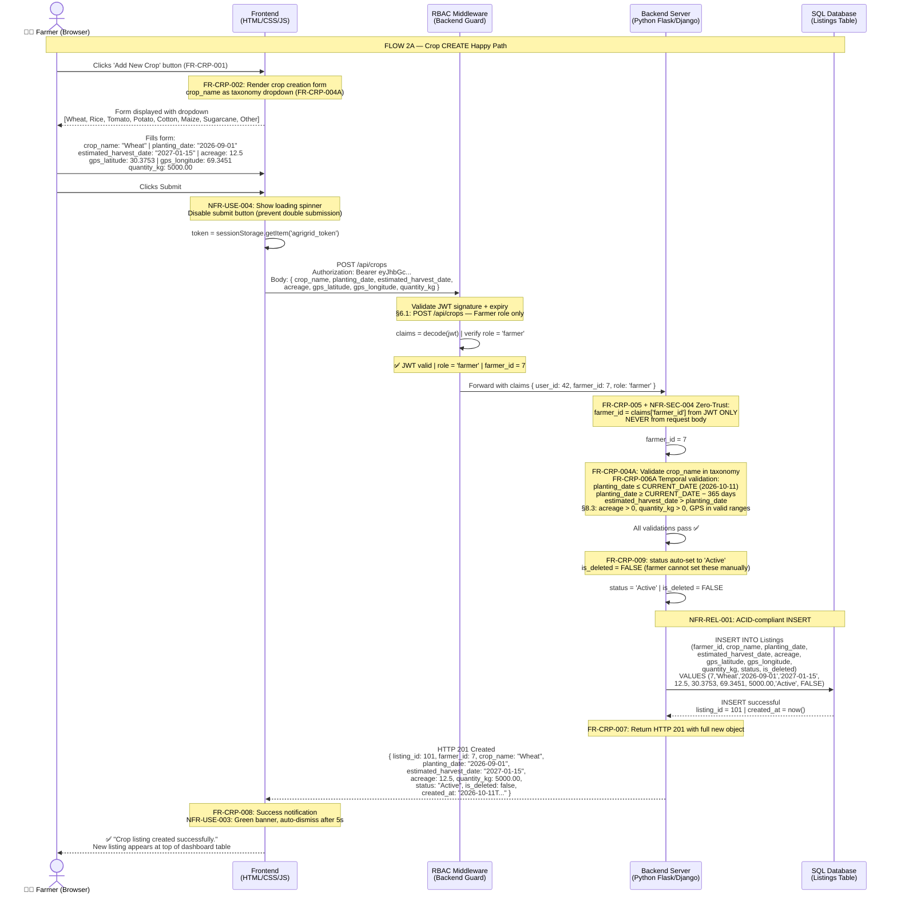

---

### 2B-1 — Role & RBAC Rejection

> **v1.1 Fix:** Separated from monolithic 2B diagram. All participants declared at top. Demonstrates `§6.1` (Buyer blocked from Farmer-only route) and `§6.3` (403 for role-level denial).

```mermaid
sequenceDiagram
    actor Buyer as 🏪 B2B Buyer (Browser)
    participant FE as Frontend<br/>(HTML/CSS/JS)
    participant RBAC as RBAC Middleware<br/>(Backend Guard)
    participant BE as Backend Server<br/>(Python Flask/Django)
    participant DB as SQL Database

    Note over Buyer,DB: FLOW 2B-1 — Role & RBAC Rejection<br/>Non-Farmer role attempting POST /api/crops

    Buyer->>FE: Attempts to submit crop via POST /api/crops<br/>[JWT contains role='buyer']
    FE->>FE: token = sessionStorage.getItem('agrigrid_token')
    FE->>RBAC: POST /api/crops<br/>Authorization: Bearer eyJhbGc... [role='buyer']

    Note over RBAC: JWT is cryptographically valid.<br/>Extract role claim: role = 'buyer'
    RBAC->>RBAC: claims = decode(jwt)<br/>role = claims['role'] → 'buyer'

    Note over RBAC: §6.1 Route Matrix:<br/>POST /api/crops: Farmer ✅ | B2B Buyer ❌<br/>§6.3: Role-level denial → HTTP 403<br/>(Not 404 — the route exists; the role is wrong)
    RBAC-->>FE: HTTP 403 Forbidden<br/>{ "error": "Access denied. You do not have permission to access this resource." }
    FE-->>Buyer: ❌ Access denied — request terminated at RBAC layer<br/>Backend and DB are never reached
```

---

### 2B-2 — Input & Temporal Validation Cascade

> **v1.1 Fix:** Separated from monolithic 2B. Participant `Farmer` declared at top. Uses `alt...else...end` to show that only ONE branch fires per request — these are mutually exclusive failure modes of a single submission. Demonstrates `FR-CRP-004A` (taxonomy), `FR-CRP-006A` (temporal), and `§8.3` (error table).

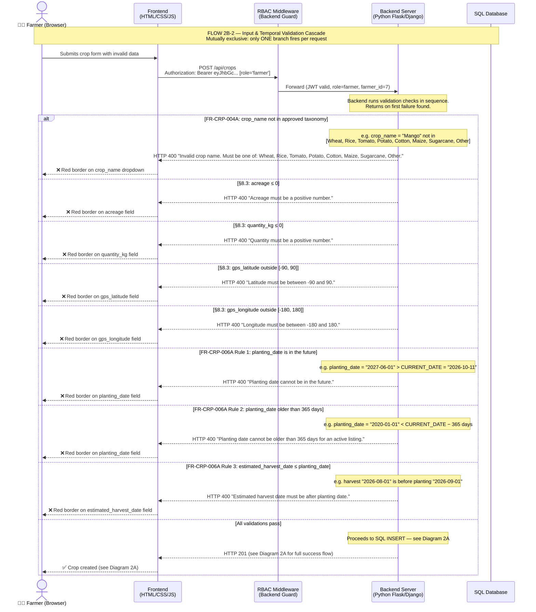

---

### 2B-3 — DB Write Failure & Rollback

> **v1.1 Fix:** Isolated from 2B monolith. Demonstrates `NFR-REL-001` (ACID rollback on INSERT failure), `§8.3` (HTTP 500 response), `NFR-USE-003` (red error banner), `NFR-USE-004` (spinner removed, button re-enabled).

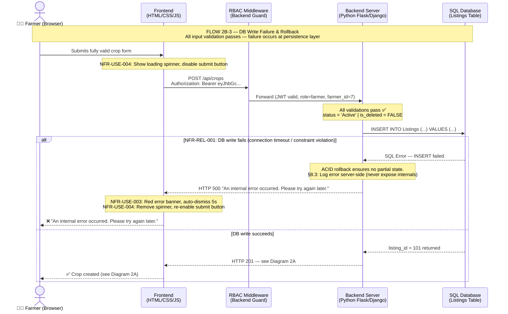

---

## Diagram 3 — Active Crop READ (Paginated List)

> **SRS Reference:** `FR-CRP-010`, `FR-CRP-011`, `FR-CRP-012`, `FR-CRP-013`, `NFR-SEC-004`, `NFR-REL-001`, `§6.1`, `§6.2`
>
> **Key SRS Rules:** `FR-CRP-011` — `GET /api/crops?page=1&limit=20` with pagination metadata `{ data, page, limit, total }`. Two-query pattern: `COUNT(*)` for total, then `SELECT` with `LIMIT/OFFSET`. `NFR-SEC-004` Zero-Trust: `farmer_id` from JWT only. Filter: `is_deleted = FALSE`.

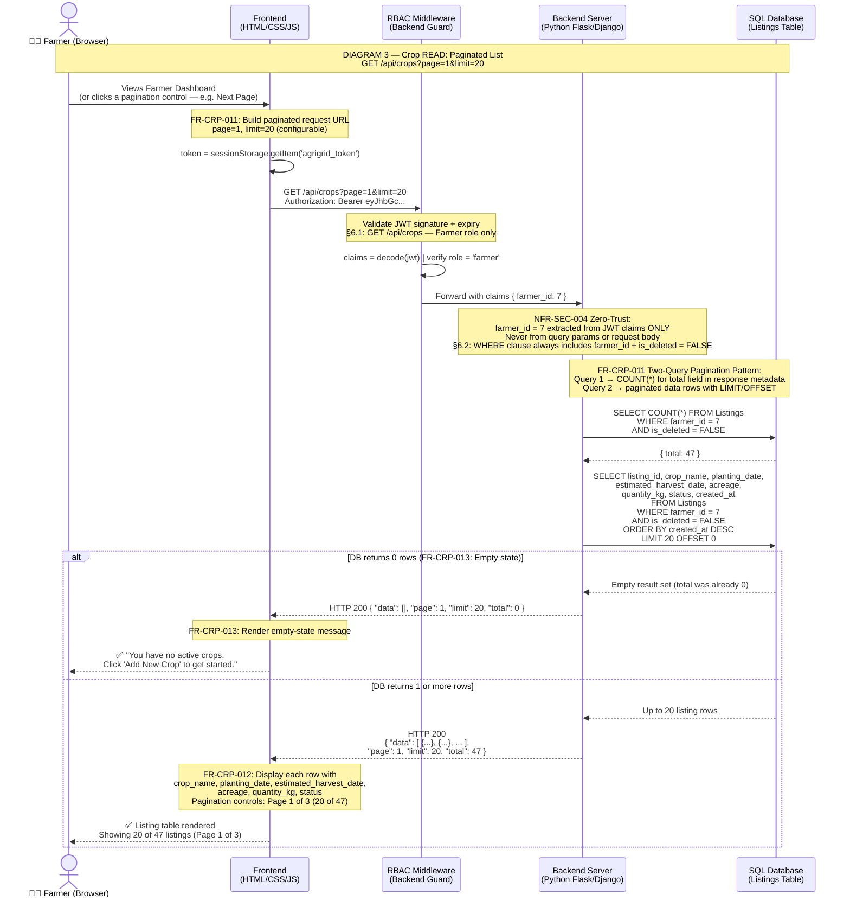

---

## Diagram 4 — Active Crop READ (Single Detail)

> **SRS Reference:** `FR-CRP-014`, `FR-CRP-014A`, `§6.1`, `§6.2`, `§6.3`, `§8.3`

---

### 4A — Happy Path: Single Listing Retrieved

> **Key SRS Rules:** `FR-CRP-014` — Farmer clicks listing to view full detail. `FR-CRP-014A` — `GET /api/crops/{listing_id}` returns HTTP 200 with full object including GPS coordinates. Zero-Trust composite query: `WHERE listing_id = ? AND farmer_id = ? AND is_deleted = FALSE`.

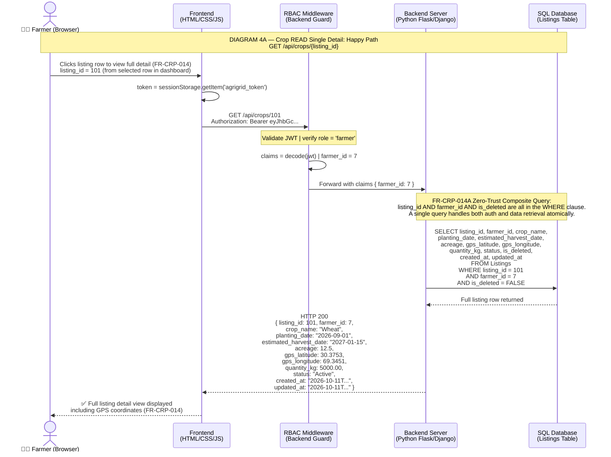

---

### 4B — Security Check: Unified 404 Response

> **Key SRS Rules:** `FR-CRP-014A` — Backend returns HTTP **404** (not 403) for both "listing does not exist" AND "listing belongs to a different farmer." The composite `WHERE` clause makes both scenarios produce an identical empty result — the backend cannot and does not distinguish between them. This is the CTO GAP-3 Fix: prevents integer-based listing ID enumeration across tenants.

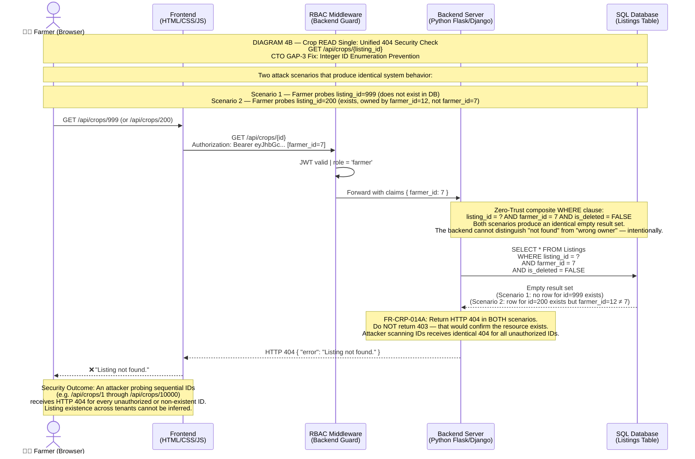

---

## Diagram 5 — Active Crop UPDATE

> **SRS Reference:** `FR-CRP-015`, `FR-CRP-016`, `FR-CRP-017`, `FR-CRP-018`, `FR-CRP-019`, `FR-CRP-020`, `FR-CRP-021`, `FR-CRP-004A`, `FR-CRP-006A`, `§6.1`, `§6.2`, `§8.3`, `NFR-REL-001`
>
> **Key SRS Rules:** `FR-CRP-016` — form pre-filled via `GET /api/crops/{id}` (see Diagram 4A). `FR-CRP-018` — `PUT /api/crops/{listing_id}`. `FR-CRP-019` — ownership check returns HTTP **404** (not 403) if not found or belongs to another farmer. `NFR-REL-001` — ACID-compliant SQL UPDATE.

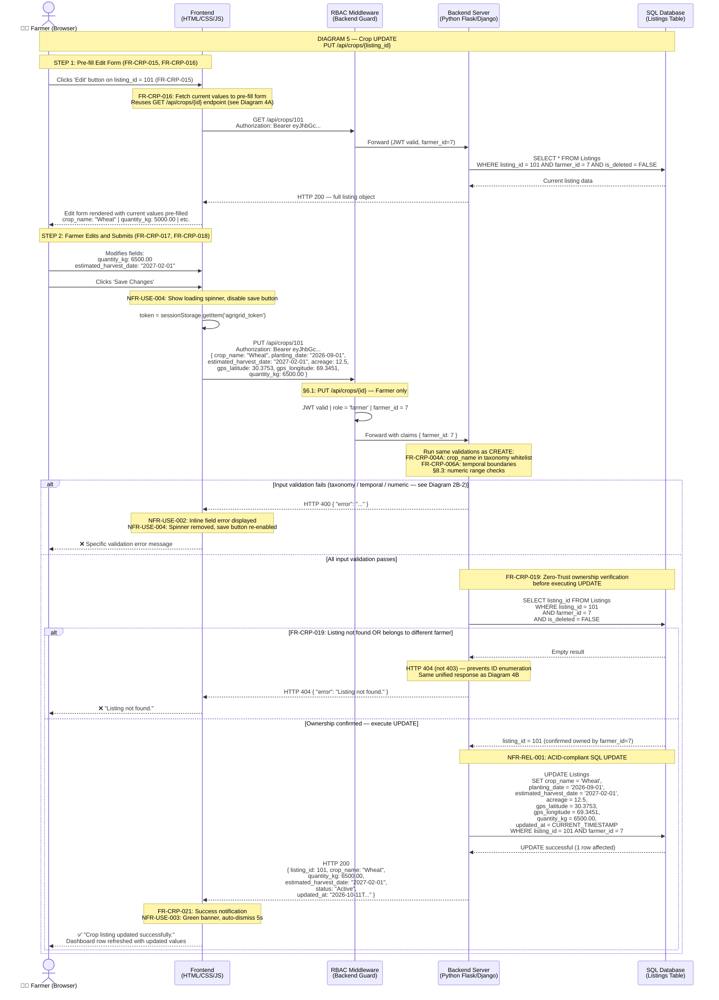

---

## Diagram 6 — Active Crop WITHDRAW (Soft-Delete)

> **SRS Reference:** `FR-CRP-022`, `FR-CRP-023`, `FR-CRP-024`, `FR-CRP-025`, `FR-CRP-026`, `FR-CRP-027`, `§6.1`, `§6.2`, `§6.3`, `§8.3`, `NFR-REL-001`
>
> **Key SRS Rules:** `FR-CRP-022` — UI button labeled **"Withdraw"** (not "Delete"). `FR-CRP-023` — Confirmation dialog. `FR-CRP-024` — HTTP method is `DELETE` but backend behavior is a soft-delete. `FR-CRP-025` — Physical SQL `DELETE` is **PROHIBITED**. Backend executes `UPDATE ... SET is_deleted = TRUE, status = 'Withdrawn'`. `FR-CRP-027` — Remove row from dashboard without reload. Provenance reason: `Listings` rows are FK roots for Increments 2–5 (Escrow, Telemetry, Diagnostics, QR Storyboard).

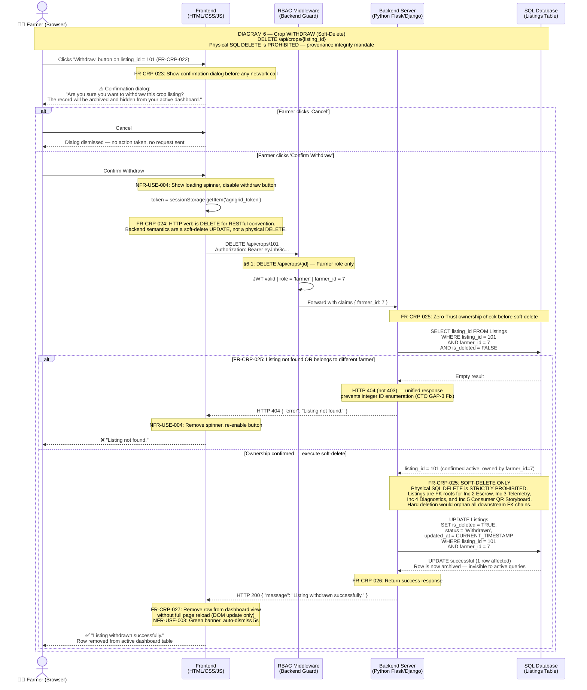

---

## Participant Legend

| Participant Symbol | Full Name | Technology (Increment 1) | SRS Section |
|---|---|---|---|
| 👨‍🌾 Farmer (Browser) | The Farmer Actor | Any modern browser (Chrome, Firefox, Safari, Edge — latest 2 versions) | §2.2, §2.3 |
| 🏪 B2B Buyer (Browser) | The B2B Buyer Actor (Increment 1: provisioned only) | Same browser stack — shown in 2B-1 for RBAC rejection demo | §2.2 |
| Frontend (HTML/CSS/JS) | The Presentation Layer | HTML5, CSS3, Vanilla JavaScript with fetch/axios | §2.3, Doc 3 §1 |
| RBAC Middleware (Backend Guard) | The Security Gateway | Python decorator / middleware on Flask/Django routes | §6.1, §6.2, §6.3 |
| Backend Server (Python Flask/Django) | The Application Logic Layer | Python 3.x — Flask or Django | §2.3, Doc 3 §1 |
| SQL Database | The Persistence Layer | SQLite3 (prototype) → MySQL/PostgreSQL (deployment) | §2.3, §7.1–7.4, Doc 3 §1 |

---

## SRS Requirement Traceability

| Diagram | Requirement IDs Demonstrated |
|---|---|
| **1A — Farmer Registration** | FR-LGN-017, FR-LGN-018, FR-LGN-018A, FR-LGN-019, FR-LGN-020, FR-LGN-021, NFR-SEC-001, NFR-SEC-008, §8.2 |
| **1B — Login & JWT Issuance** | FR-LGN-004–FR-LGN-016, FR-LGN-022, §3.3 JWT Contract, NFR-SEC-001, NFR-PERF-001 (LEFT JOIN optimization) |
| **1C — Route Guard & Dashboard Load** | FR-LGN-011, FR-LGN-013, FR-LGN-022, FR-LGN-023, FR-CRP-011, NFR-SEC-002, NFR-SEC-003, §6.1, §6.3 |
| **2A — Crop CREATE (Happy Path)** | FR-CRP-001–FR-CRP-009, FR-CRP-004A, FR-CRP-005, FR-CRP-006A, NFR-SEC-004, NFR-REL-001, NFR-USE-003, NFR-USE-004 |
| **2B-1 — RBAC Role Rejection** | §6.1 (Route Matrix), §6.3 (403 role-level denial) |
| **2B-2 — Input & Temporal Validation** | FR-CRP-004A, FR-CRP-006A (Rules 1–3), §8.3 (all validation error rows), NFR-USE-002 |
| **2B-3 — DB Write Failure** | NFR-REL-001 (ACID rollback), §8.3 (HTTP 500 row), NFR-USE-003, NFR-USE-004 |
| **3 — Crop READ (Paginated List)** | FR-CRP-010, FR-CRP-011 (pagination + COUNT(*) + LIMIT/OFFSET), FR-CRP-012, FR-CRP-013, NFR-SEC-004, §6.1, §6.2 |
| **4A — Crop READ (Single — Happy Path)** | FR-CRP-014, FR-CRP-014A, §6.1, §6.2, NFR-SEC-004 |
| **4B — Crop READ (Single — Unified 404)** | FR-CRP-014A, §6.2, §6.3, §8.3 (CTO GAP-3: enumeration prevention) |
| **5 — Crop UPDATE** | FR-CRP-015–FR-CRP-021, FR-CRP-004A, FR-CRP-006A, FR-CRP-019 (404 ownership check), NFR-REL-001, NFR-USE-002, NFR-USE-003, NFR-USE-004, §6.1, §6.2, §8.3 |
| **6 — Crop WITHDRAW (Soft-Delete)** | FR-CRP-022–FR-CRP-027, FR-CRP-025 (soft-delete SQL, hard DELETE PROHIBITED), §6.1, §6.2, §8.3, NFR-REL-001, NFR-USE-003, NFR-USE-004 |

---

## Revision History

| Version | Date | Author | Changes |
|---|---|---|---|
| 1.0 | 2026-10-11 | Requirements & Architecture Agent | Initial release. Five diagrams covering Flows 1A, 1B, 1C, 2A, 2B (monolithic). |
| 1.1 | 2026-10-11 | Requirements & Architecture Agent — CTO Review Applied | **Critical Fixes:** (1) All `alt...end` fall-through blocks replaced with `alt...else...end` proper branching — errors now visually terminate execution. (2) Login (1B) optimized to single LEFT JOIN query (eliminates redundant DB round-trip, supports NFR-PERF-001). (3) Added COUNT(*) companion query in 1C for pagination `total` field (FR-CRP-011). (4) Split monolithic 2B into three isolated sub-flows: 2B-1 (RBAC rejection), 2B-2 (validation cascade), 2B-3 (DB failure). (5) Moved Buyer actor declaration to diagram top (fixes Mermaid layout rendering bug). **New Diagrams:** Added Diagram 3 (READ paginated list), Diagram 4A/4B (READ single detail + unified 404), Diagram 5 (UPDATE with pre-fill + ownership check), Diagram 6 (WITHDRAW soft-delete with confirmation dialog + SQL). Traceability matrix updated. |

---

*End of Document — AG-SSD-INC1-002 v1.1*
