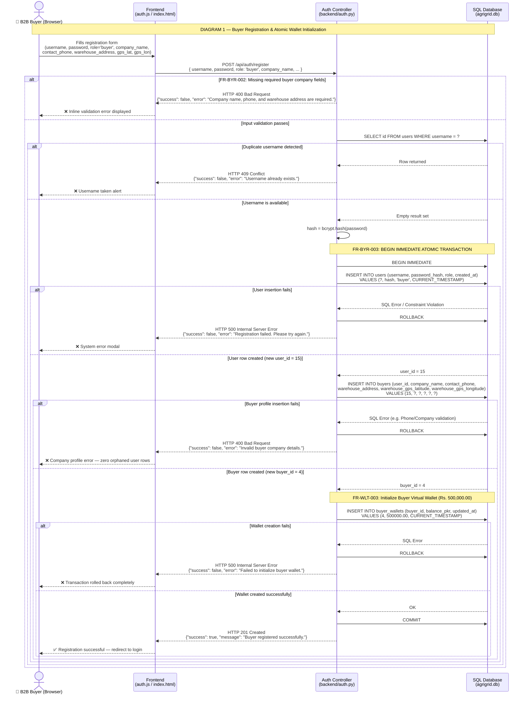
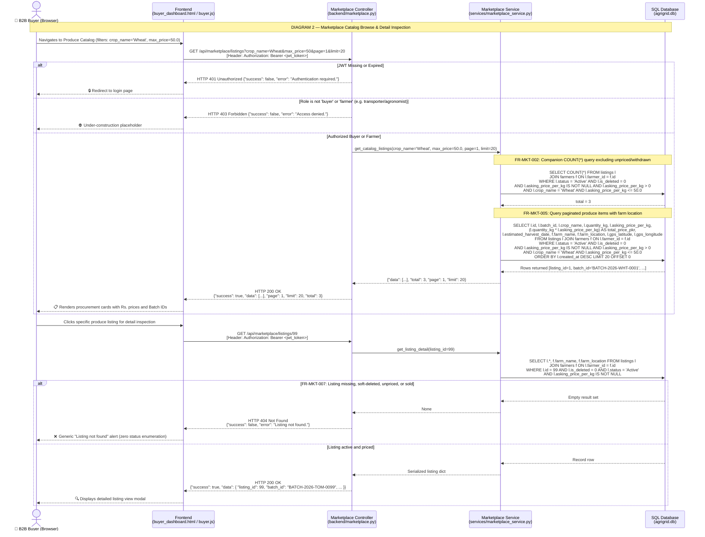
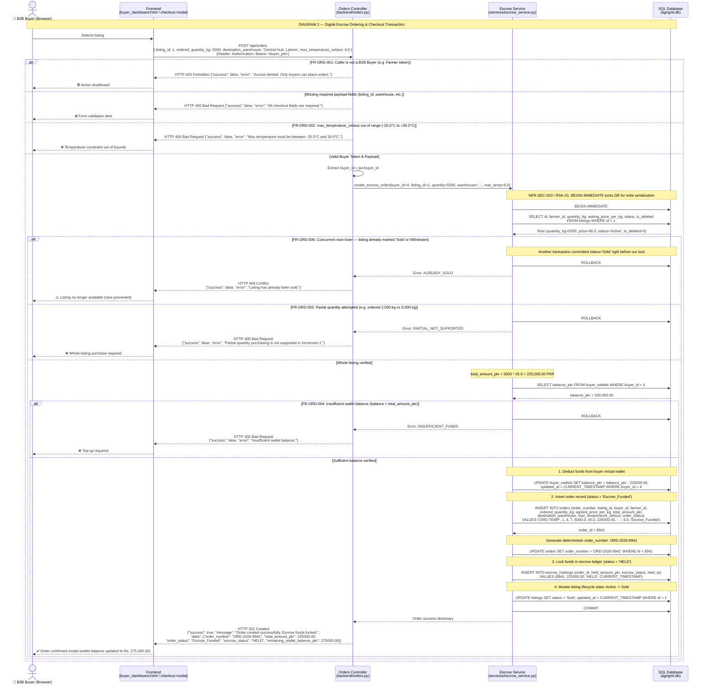
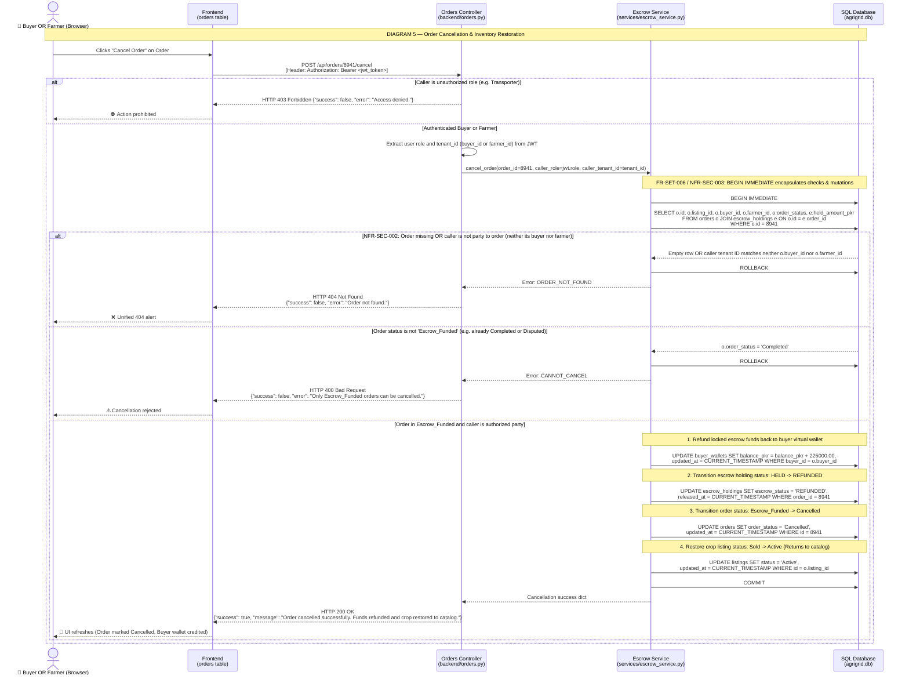
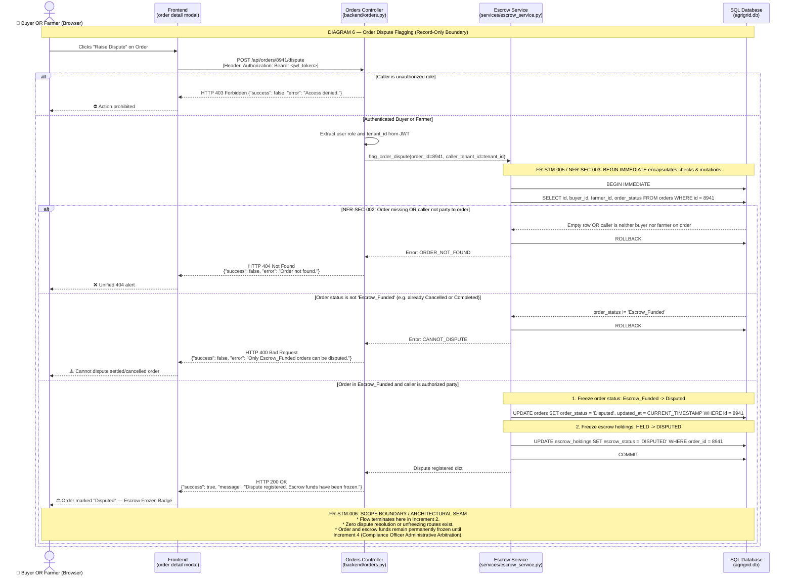
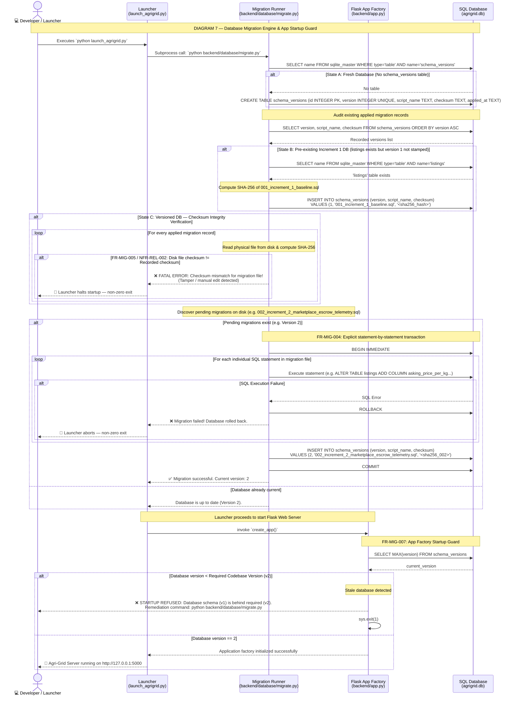
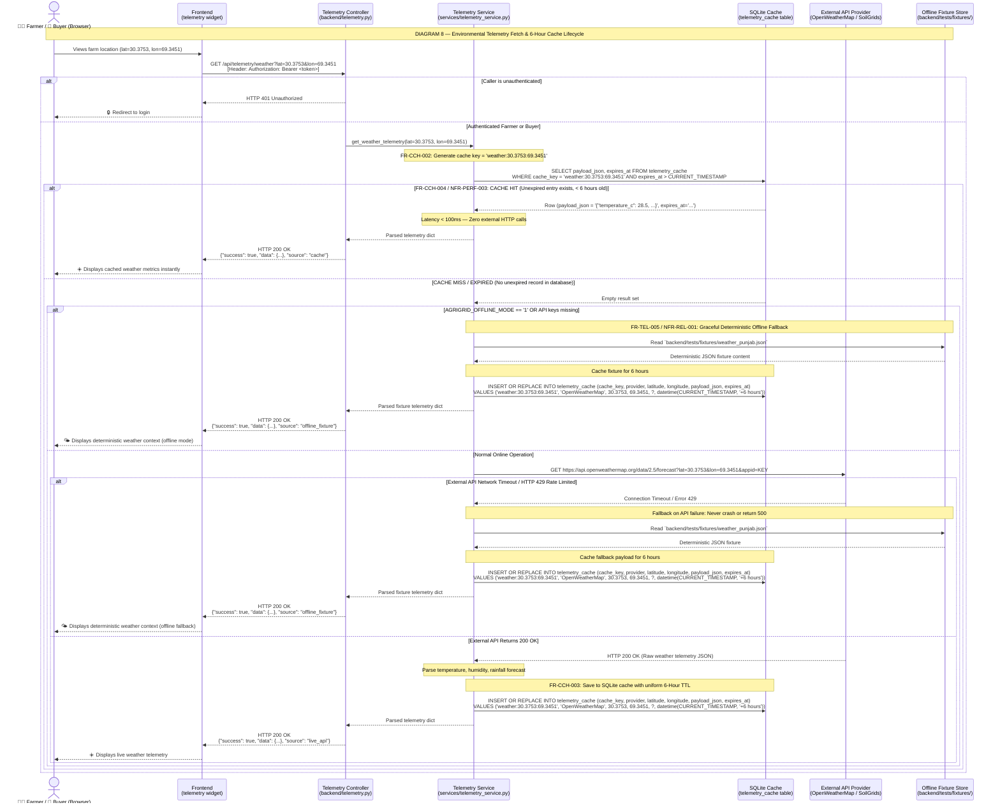
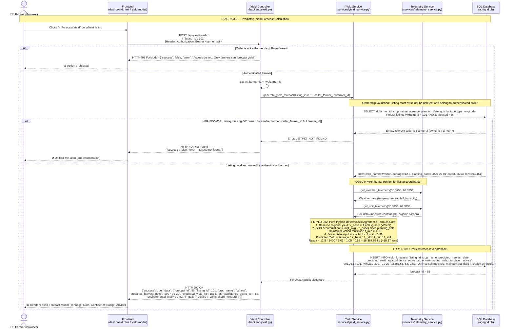
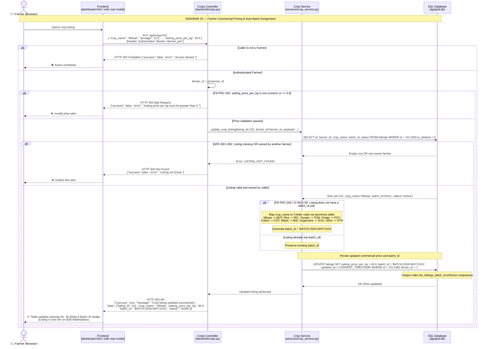
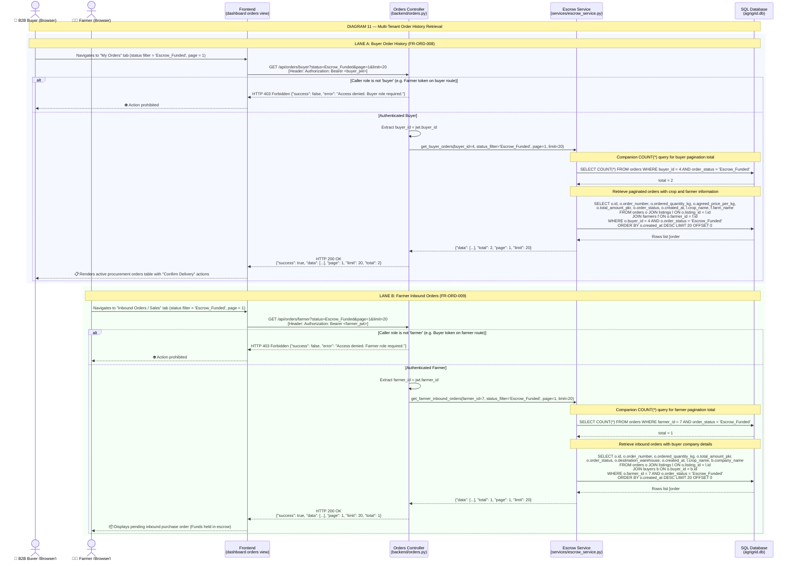

# System Sequence Diagrams
## Increment 2: Core Data Engine & Demand Side (B2B Marketplace, Escrow & Predictive Yield)

| Field | Value |
|---|---|
| **Project Name** | Agri-Grid: Smart Agriculture & Food Security Ecosystem |
| **Document ID** | `AG-SSD-INC2-002` |
| **Version** | 1.1 (Formal Deliverable — Fact-Check Fix Release) |
| **Prepared By** | Iqra Fayaz (Software Architect & API Designer) & Manahil Sohail (Lead Requirements Engineer) |
| **Reviewed By** | Ameer Muawiyah (Scrum Master + Lead Data Architect) |
| **Date** | 2026-11-14 |
| **Baseline Source** | `AG-SRS-INC2-001 v1.2` & `AG-PLAN-INC2-001 v1.1` |
| **Increment 1 Reference** | `AG-SSD-INC1-002 v1.1` (`2_Farmer_Sequence_Diagrams.md`) |
| **Location** | `./Documentation/Increment_2_Sequence_Diagrams.md` |

---

## Table of Contents

1. [Architectural Execution Rules & Modeling Standards](#1-architectural-execution-rules--modeling-standards)
2. [Diagram 1 — Buyer Onboarding & Atomic Wallet Initialization](#diagram-1--buyer-onboarding--atomic-wallet-initialization)
3. [Diagram 2 — Marketplace Catalog Browse & Detail Inspection](#diagram-2--marketplace-catalog-browse--detail-inspection)
4. [Diagram 3 — Digital Escrow Ordering & Checkout Transaction](#diagram-3--digital-escrow-ordering--checkout-transaction)
5. [Diagram 4 — Delivery Confirmation & Escrow Settlement](#diagram-4--delivery-confirmation--escrow-settlement)
6. [Diagram 5 — Order Cancellation & Inventory Restoration](#diagram-5--order-cancellation--inventory-restoration)
7. [Diagram 6 — Order Dispute Flagging (Record-Only Boundary)](#diagram-6--order-dispute-flagging-record-only-boundary)
8. [Diagram 7 — Database Migration Engine & App Startup Guard](#diagram-7--database-migration-engine--app-startup-guard)
9. [Diagram 8 — Environmental Telemetry Fetch & 6-Hour Cache Lifecycle](#diagram-8--environmental-telemetry-fetch--6-hour-cache-lifecycle)
10. [Diagram 9 — Predictive Yield Forecast Calculation](#diagram-9--predictive-yield-forecast-calculation)
11. [Diagram 10 — Farmer Commercial Pricing & Auto-Batch Assignment](#diagram-10--farmer-commercial-pricing--auto-batch-assignment)
12. [Diagram 11 — Multi-Tenant Order History Retrieval](#diagram-11--multi-tenant-order-history-retrieval)
13. [Global Participant Legend](#13-global-participant-legend)
14. [Traceability Matrix (Diagrams to SRS v1.2 Requirements)](#14-traceability-matrix-diagrams-to-srs-v12-requirements)
15. [Revision History & Sign-Off Block](#15-revision-history--sign-off-block)

---

## 1. Architectural Execution Rules & Modeling Standards

These sequence diagrams visually specify the runtime interactions between actors, presentation components, HTTP controllers, decoupled service modules, and the SQLite database (`backend/database/agrigrid.db`) for **Increment 2**, strictly following `AG-SRS-INC2-001 v1.2`:

1. **UML 2.5 Strict Control Flow**: Every conditional branch is modeled using `alt [Condition] ... else [Condition] ... end`. Standalone fall-through `alt` blocks are prohibited; execution visually terminates on error branches.
2. **Top-Level Participant Declarations**: All lifelines (`actor`, `participant`) are declared at the head of every diagram to prevent layout glitches and lifeline stacking.
3. **Behavior-Preserving Service Layer Separation**: Depicts the service extraction boundary (`FR-SRV-001` through `FR-SRV-004`). Route controllers delegate business logic and SQL execution directly to dedicated modules in `backend/services/`.
4. **Zero-Trust Tenant Isolation & Unified 404 Policy (`NFR-SEC-002`)**:
   - Calling an endpoint with an **unauthorized role** (e.g., a farmer calling a buyer checkout route) returns **HTTP 403 Forbidden**.
   - Calling an endpoint with an **authorized role but non-owner identity** (e.g., Buyer B attempting to confirm Buyer A's order) returns unified **HTTP 404 Not Found** with a generic error envelope to prevent resource enumeration.
5. **ACID Financial Integrity & Concurrency Locking**: All escrow balance deductions, wallet credits, order creation, status transitions, and precondition checks execute within explicit SQLite `BEGIN IMMEDIATE` transactions to prevent concurrent double-spending or duplicate settlement.
6. **Immutable Identification & Vocabulary Standards**:
   - Batch IDs: `BATCH-{YEAR}-{CROP_CODE3}-{LISTING_ID:04d}` (e.g., `BATCH-2026-WHT-0001`).
   - Order Numbers: `ORD-{YYYY}-{ORDER_ID:04d}` (e.g., `ORD-2026-0001`).
   - Telemetry Cache Keys: `weather:{lat}:{lon}` and `soil:{lat}:{lon}`.
   - Crop Statuses: `VALID_STATUSES = frozenset(["Active", "Sold", "In Transit", "Delivered", "Withdrawn"])`.

---

## Diagram 1 — Buyer Onboarding & Atomic Wallet Initialization

> **SRS Reference:** `FR-BYR-001`, `FR-BYR-002`, `FR-BYR-003`, `FR-BYR-004`, `FR-WLT-003`, `NFR-SEC-003`  
> **Key Rules:** Atomic multi-table insertion (`users` + `buyers` + `buyer_wallets`) in a single transaction; mandatory company metadata; automatic wallet balance initialization with `SIMULATED_BUYER_STARTING_BALANCE_PKR = 500000.00`; full rollback on failure leaving zero orphaned records.



---

## Diagram 2 — Marketplace Catalog Browse & Detail Inspection

> **SRS Reference:** `FR-MKT-001`, `FR-MKT-002`, `FR-MKT-003`, `FR-MKT-004`, `FR-MKT-005`, `FR-MKT-006`, `FR-MKT-007`, `NFR-SEC-002`  
> **Key Rules:** Price-gated public catalog (`status = 'Active'` AND `is_deleted = 0` AND `asking_price_per_kg > 0`); Increment 1 flat list envelope (`data`, `page`, `limit`, `total`); unified 404 anti-enumeration on single listing lookup.



---

## Diagram 3 — Digital Escrow Ordering & Checkout Transaction

> **SRS Reference:** `FR-ORD-001` through `FR-ORD-007`, `FR-STM-002`, `NFR-SEC-003`, `NFR-PERF-002`, `RSK-01`  
> **Key Rules:** Buyer-only checkout; strict whole-listing purchase validation (`ordered_quantity_kg == listing.quantity_kg`); cold-chain temperature range check (`-25.0°C` to `+30.0°C`); atomic execution under SQLite `BEGIN IMMEDIATE` to prevent race condition double-selling (`409 Conflict`); deterministic order number `ORD-{YYYY}-{ORDER_ID:04d}`.



---

## Diagram 4 — Delivery Confirmation & Escrow Settlement

> **SRS Reference:** `FR-SET-001`, `FR-SET-002`, `FR-SET-003`, `FR-SET-004`, `NFR-SEC-002`, `NFR-SEC-003`, `Plan §13 Decision 3`  
> **Key Rules:** Buyer quality acceptance doubles as delivery settlement in Increment 2; transaction opens with `BEGIN IMMEDIATE` prior to precondition checks to serialize concurrency; cross-tenant ownership check returns unified `HTTP 404`; status precondition strictly `'Escrow_Funded'`; populates `orders.delivered_at` and `escrow_holdings.auto_release_at` (`delivered_at + 72h`); invokes `release_escrow(order_id, trigger='buyer_confirmation')` crediting farmer wallet and recording trigger in `release_tx_ref`.

```mermaid
sequenceDiagram
    actor Buyer as 🛒 B2B Buyer (Browser)
    participant FE as Frontend<br/>(buyer_dashboard.html / orders tab)
    participant BE as Orders Controller<br/>(backend/orders.py)
    participant SRV as Escrow Service<br/>(services/escrow_service.py)
    participant DB as SQL Database<br/>(agrigrid.db)

    Note over Buyer,DB: DIAGRAM 4 — Delivery Confirmation & Escrow Settlement

    Buyer->>FE: Reviews delivery inspection score<br/>Clicks "Confirm Delivery & Release Escrow" on Order #8941
    FE->>BE: POST /api/orders/8941/confirm-delivery<br/>[Header: Authorization: Bearer <buyer_jwt>]

    alt Caller is not a Buyer (e.g. Farmer token)
        BE-->>FE: HTTP 403 Forbidden {"success": false, "error": "Access denied."}
        FE-->>Buyer: ⛔ Action prohibited
    else Authenticated Buyer
        BE->>BE: buyer_id = jwt.buyer_id
        BE->>SRV: confirm_order_delivery(order_id=8941, caller_buyer_id=buyer_id)
        
        Note over SRV,DB: FR-SET-003 / NFR-SEC-003: BEGIN IMMEDIATE encapsulates checks & mutations
        SRV->>DB: BEGIN IMMEDIATE
        
        SRV->>DB: SELECT o.id, o.buyer_id, o.farmer_id, o.order_status, e.held_amount_pkr, e.escrow_status<br/>FROM orders o JOIN escrow_holdings e ON o.id = e.order_id<br/>WHERE o.id = 8941
        
        alt NFR-SEC-002: Order missing OR owned by another buyer (caller_buyer_id != o.buyer_id)
            DB-->>SRV: Empty row OR caller is Buyer 9 (owner is Buyer 4)
            SRV->>DB: ROLLBACK
            SRV-->>BE: Error: ORDER_NOT_FOUND
            BE-->>FE: HTTP 404 Not Found<br/>{"success": false, "error": "Order not found."}
            FE-->>Buyer: ❌ Unified 404 alert (anti-enumeration)
        else FR-SET-002: Order is not in 'Escrow_Funded' status (e.g. already Completed / Disputed)
            DB-->>SRV: o.order_status = 'Completed'
            SRV->>DB: ROLLBACK
            SRV-->>BE: Error: INVALID_STATUS
            BE-->>FE: HTTP 400 Bad Request<br/>{"success": false, "error": "Order cannot be confirmed in current status."}
            FE-->>Buyer: ⚠️ Order already settled
        else Order valid & caller is verified owner
            Note over SRV,DB: 1. Set orders.order_status = 'Completed' and record delivered_at
            SRV->>DB: UPDATE orders SET order_status = 'Completed', delivered_at = CURRENT_TIMESTAMP,<br/>updated_at = CURRENT_TIMESTAMP WHERE id = 8941
            
            Note over SRV,DB: 2. Populate escrow delivery timestamp and Increment 4 auto-release seam (+72h)
            SRV->>DB: UPDATE escrow_holdings SET delivered_at = CURRENT_TIMESTAMP,<br/>auto_release_at = datetime(CURRENT_TIMESTAMP, '+72 hours') WHERE order_id = 8941
            
            Note over SRV: FR-SET-004: Invoke release_escrow(8941, trigger='buyer_confirmation')
            SRV->>DB: UPDATE farmer_wallets SET balance_pkr = balance_pkr + 225000.00,<br/>updated_at = CURRENT_TIMESTAMP WHERE farmer_id = 7
            
            SRV->>DB: UPDATE escrow_holdings SET escrow_status = 'RELEASED', released_at = CURRENT_TIMESTAMP,<br/>release_tx_ref = 'TRIGGER:buyer_confirmation;REF:TX-8941-SETTLE'<br/>WHERE order_id = 8941
            
            SRV->>DB: COMMIT
            SRV-->>BE: Settlement success dict
            BE-->>FE: HTTP 200 OK<br/>{"success": true, "message": "Delivery confirmed and escrow funds released to farmer.",<br/>"data": {"order_number": "ORD-2026-8941", "order_status": "Completed", "escrow_status": "RELEASED"}}
            FE-->>Buyer: ✅ Settlement complete badge rendered
        end
    end
```

---

## Diagram 5 — Order Cancellation & Inventory Restoration

> **SRS Reference:** `FR-SET-005`, `FR-SET-006`, `FR-STM-003`, `FR-STM-004`, `NFR-SEC-002`, `NFR-SEC-003`  
> **Key Rules:** Permitted strictly when `order_status == 'Escrow_Funded'`; accessible by either the buyer or the farmer party to the order; transaction opens with `BEGIN IMMEDIATE` prior to precondition checks; non-party callers receive unified `HTTP 404`; atomically refunds buyer wallet, sets `escrow_status = 'REFUNDED'`, marks order `'Cancelled'`, and restores listing back to `'Active'` for catalog re-discovery.



---

## Diagram 6 — Order Dispute Flagging (Record-Only Boundary)

> **SRS Reference:** `FR-STM-005`, `FR-STM-006`, `NFR-SEC-002`, `NFR-SEC-003`, `Plan §2.2.6`, `Plan §4.3 Scope Note`  
> **Key Rules:** Buyer or Farmer party flags dispute on an active `Escrow_Funded` order; transaction opens with `BEGIN IMMEDIATE` prior to precondition checks; transitions `order_status = 'Disputed'` and `escrow_status = 'DISPUTED'`; funds remain permanently frozen in escrow; **explicit architectural boundary**: diagram ends at frozen state; no dispute resolution or exit route exists in Increment 2 (deferred to Increment 4 Compliance Officer).



---

## Diagram 7 — Database Migration Engine & App Startup Guard

> **SRS Reference:** `FR-MIG-001` through `FR-MIG-007`, `NFR-REL-002`, `Plan §4.1`  
> **Key Rules:** Triggered by launcher before server startup; handles three database states (fresh, baseline Inc 1 unversioned, versioned); verifies SHA-256 checksums of applied files; executes statements inside `BEGIN IMMEDIATE` / `COMMIT` (no `executescript`); Flask `app.py` startup refuses to boot if database version is behind required target (v2).



---

## Diagram 8 — Environmental Telemetry Fetch & 6-Hour Cache Lifecycle

> **SRS Reference:** `FR-TEL-001` through `FR-TEL-005`, `FR-CCH-001` through `FR-CCH-005`, `NFR-REL-001`, `NFR-PERF-003`  
> **Key Rules:** Cache key format `<telemetry_type>:<lat>:<lon>`; 6-hour uniform TTL; Cache Hit returns SQLite payload under 100ms; Cache Miss queries external API (OpenWeatherMap/SoilGrids) and saves fresh cache; Failure / Offline mode gracefully falls back to deterministic local fixtures in `backend/tests/fixtures/`, caches fixture under standard 6-hour TTL, and returns `source: "offline_fixture"`, never throwing HTTP 500.



---

## Diagram 9 — Predictive Yield Forecast Calculation

> **SRS Reference:** `FR-YLD-001` through `FR-YLD-007`, `NFR-SEC-002`, `NFR-PERF-004`, `Plan §13 Decision 5`  
> **Key Rules:** Farmer-only trigger; cross-tenant ownership check returns unified `HTTP 404`; loads listing parameters from DB; queries telemetry cache; executes deterministic agronomic formula core (GDD, rain deviation, soil stress); worked example: `12.5 * 1400 * 1.02 * 1.05 * 0.98 = 18,367.65 kg`; persists mathematical output to `yield_forecasts` table; returns predicted harvest date, yield tonnage, confidence score, and irrigation advice.



---

## Diagram 10 — Farmer Commercial Pricing & Auto-Batch Assignment

> **SRS Reference:** `FR-PRC-001` through `FR-PRC-005`, `D-INC2-08`, `NFR-SEC-002`, `Plan §5.1`  
> **Key Rules:** Farmer updates crop with commercial `asking_price_per_kg`; validates price > 0 (else HTTP 400); if `batch_id` is null, automatically generates unique identifier using template `BATCH-{YEAR}-{CROP_CODE3}-{LISTING_ID:04d}` (Wheat $\rightarrow$ `WHT`, Tomato $\rightarrow$ `TOM`, etc.); persists to `listings`; listing becomes eligible for public marketplace catalog.



---

## Diagram 11 — Multi-Tenant Order History Retrieval

> **SRS Reference:** `FR-ORD-008`, `FR-ORD-009`, `NFR-SEC-001`, `NFR-SEC-002`, `Plan §6.2`, `Plan §8`  
> **Key Rules:** Dual-lane order listing endpoints; `GET /api/orders/buyer` strictly requires `role == 'buyer'` and filters `WHERE buyer_id = jwt.buyer_id`; `GET /api/orders/farmer` strictly requires `role == 'farmer'` and filters `WHERE farmer_id = jwt.farmer_id`; both return Increment 1 list envelope (`data`, `page`, `limit`, `total`) populated via companion `COUNT(*)` query; cross-role queries rejected with `HTTP 403 Forbidden`.



---

## 13. Global Participant Legend

| Participant ID | Display Label | Architectural Role & Implementation File |
|---|---|---|
| `Buyer` | 🛒 B2B Buyer | Authenticated client running in web browser; holds JWT with `role = 'buyer'`. |
| `Farmer` | 👨‍🌾 Farmer | Authenticated client running in web browser; holds JWT with `role = 'farmer'`. |
| `User` | 👤 Buyer OR Farmer | Generic authenticated party associated with an active transaction. |
| `Ops` | 💻 Developer / Launcher | Administrative operator running local bootstrapping or launch scripts. |
| `FE` | Frontend Presentation | Vanilla ES6 JavaScript application (`frontend/js/auth.js`, `dashboard.js`, `buyer.js`). |
| `BE` | Flask HTTP Controllers | API route endpoints mapping HTTP requests to services (`crops.py`, `marketplace.py`, `orders.py`, `telemetry.py`, `yield.py`). |
| `SRV` | Pure Service Layer | Extracted business logic layer handling domain rules and transactions (`backend/services/`). |
| `YLD` | Yield Prediction Service | Algorithmic agronomic mathematical calculation engine (`backend/services/yield_service.py`). |
| `TEL` | Telemetry Client Service | Weather and soil query client with rate-limit protection (`backend/services/telemetry_service.py`). |
| `MIG` | Migration Runner | Version-tracking zero-dependency database migration engine (`backend/database/migrate.py`). |
| `APP` | Application Factory | Flask app bootstrap factory with version startup guards (`backend/app.py`). |
| `DB` | SQLite Relational Database | Physical multi-table relational persistence store (`backend/database/agrigrid.db`). |
| `EXT` | External REST APIs | Third-party meteorological (OpenWeatherMap) and edaphic (SoilGrids) services. |
| `FIX` | Offline Fixture Store | High-fidelity local mock files (`backend/tests/fixtures/*.json`) for deterministic fallback. |

---

## 14. Traceability Matrix (Diagrams to SRS v1.2 Requirements)

| Diagram # | Diagram Title | Primary Flow / Operational Scope | Governed SRS v1.2 Requirement IDs |
|:---:|---|---|---|
| **1** | Buyer Onboarding & Atomic Wallet Initialization | Atomic User + Buyer + Wallet insertion; Rs. 500k starting credit; rollback handling | `FR-BYR-001`, `FR-BYR-002`, `FR-BYR-003`, `FR-BYR-004`, `FR-WLT-003`, `NFR-SEC-003` |
| **2** | Marketplace Catalog Browse & Detail Inspection | Price-gated public catalog; pagination envelope; unified 404 anti-enumeration detail | `FR-MKT-001`, `FR-MKT-002`, `FR-MKT-003`, `FR-MKT-004`, `FR-MKT-005`, `FR-MKT-006`, `FR-MKT-007`, `NFR-SEC-002` |
| **3** | Digital Escrow Ordering & Checkout Transaction | Whole-listing rule; temp bounds (-25°C to +30°C); balance deduction; order & escrow creation; `BEGIN IMMEDIATE` double-sell prevention | `FR-ORD-001`, `FR-ORD-002`, `FR-ORD-003`, `FR-ORD-004`, `FR-ORD-005`, `FR-ORD-006`, `FR-ORD-007`, `FR-STM-002`, `NFR-SEC-003` |
| **4** | Delivery Confirmation & Escrow Settlement | Atomic transaction wrapping precondition check; ownership check (404); status check; delivery timestamps; `release_escrow()` trigger logging | `FR-SET-001`, `FR-SET-002`, `FR-SET-003`, `FR-SET-004`, `NFR-SEC-002`, `NFR-SEC-003` |
| **5** | Order Cancellation & Inventory Restoration | Atomic transaction wrapping precondition check; buyer balance refund; escrow status `REFUNDED`; listing returned to `Active` | `FR-SET-005`, `FR-SET-006`, `FR-STM-003`, `FR-STM-004`, `NFR-SEC-002`, `NFR-SEC-003` |
| **6** | Order Dispute Flagging (Record-Only Boundary) | Atomic transaction wrapping precondition check; freezes order and escrow; record-only termination; Increment 4 arbitration seam | `FR-STM-005`, `FR-STM-006`, `NFR-SEC-002`, `NFR-SEC-003` |
| **7** | Database Migration Engine & App Startup Guard | 3 initial states; checksum validation; statement execution; `app.py` stale schema boot refusal | `FR-MIG-001`, `FR-MIG-002`, `FR-MIG-003`, `FR-MIG-004`, `FR-MIG-005`, `FR-MIG-006`, `FR-MIG-007`, `NFR-REL-002` |
| **8** | Environmental Telemetry Fetch & 6-Hour Cache Lifecycle | Cache lookup (< 100ms); 6h TTL; external API fetch; failure caching; deterministic offline fixture fallback (`source: "offline_fixture"`) | `FR-TEL-001`, `FR-TEL-002`, `FR-TEL-003`, `FR-TEL-004`, `FR-TEL-005`, `FR-CCH-001`, `FR-CCH-002`, `FR-CCH-003`, `FR-CCH-004`, `FR-CCH-005`, `NFR-REL-001` |
| **9** | Predictive Yield Forecast Calculation | Listing load (404 check); cached telemetry feed; deterministic formula core (18,367.65 kg); forecast persistence | `FR-YLD-001`, `FR-YLD-002`, `FR-YLD-003`, `FR-YLD-004`, `FR-YLD-005`, `FR-YLD-006`, `FR-YLD-007`, `NFR-SEC-002`, `NFR-PERF-004` |
| **10** | Farmer Commercial Pricing & Auto-Batch Assignment | Asking price validation; deterministic `batch_id` generation (`BATCH-{YEAR}-{CROP}-{ID}`); catalog readiness | `FR-PRC-001`, `FR-PRC-002`, `FR-PRC-003`, `FR-PRC-004`, `FR-PRC-005`, `D-INC2-08`, `NFR-SEC-002` |
| **11** | Multi-Tenant Order History Retrieval | Dual-lane buyer/farmer history; role guards (403); companion `COUNT(*)`; Increment 1 envelope | `FR-ORD-008`, `FR-ORD-009`, `NFR-SEC-001`, `NFR-SEC-002` |

---

## 15. Revision History & Sign-Off Block

### 15.1 Revision History

| Version | Date | Author | Description of Changes |
|---|---|---|---|
| **v1.0** | 2026-11-14 | Iqra Fayaz (Architect) & Manahil Sohail (RE) | Initial release of Increment 2 System Sequence Diagrams (`AG-SSD-INC2-002`) depicting all 11 core architectural flows across Demand Side, Escrow Engine, Migration Infrastructure, Environmental Telemetry, Predictive Yield, and Commercial Pricing, grounded strictly in `AG-SRS-INC2-001 v1.2`. |
| **v1.1** | 2026-11-14 | Iqra Fayaz (Architect) & Manahil Sohail (RE) | Fact-check fix release: moved precondition checks inside `BEGIN IMMEDIATE` transaction blocks in Diagrams 4, 5, 6 (F1); corrected worked formula arithmetic to 18,367.65 kg in Diagram 9 (F2); aligned telemetry source discriminator to `offline_fixture` and added cache write on API failure in Diagram 8 (F3); added explicit temperature validation branch (-25°C to +30°C) in Diagram 3 (F4); removed ungrounded 'Active' status assertion from Diagram 9 ownership note (F5); removed stray `FR-WLT-003` reference from Diagram 3 header (F6); preserved blank Scrum Master approval block pending spot-check. |

### 15.2 Verification & Validation Sign-Off

```
================================================================================
AGRI-GRID SOFTWARE ENGINEERING V&V ACCEPTANCE GATE
Stage: Increment 2 Requirements Engineering Track (Deliverable 2 of 3)
Document ID: AG-SSD-INC2-002 v1.1
================================================================================

[X] Software Architect & API Designer:
    Name:      Iqra Fayaz
    Role:      System Architect & Sequence Blueprint Lead
    Signature: I. Fayaz
    Date:      2026-11-14
    Status:    FIXES APPLIED — SUBMITTED FOR SPOT-CHECK REVIEW

[X] Lead Requirements Engineer:
    Name:      Manahil Sohail
    Role:      Requirements Engineering Track Lead
    Signature: M. Sohail
    Date:      2026-11-14
    Status:    TRACEABILITY CERTIFIED AGAINST SRS v1.2

[X] Scrum Master & Lead Data Architect:
    Name:      Ameer Muawiyah
    Role:      Project Manager, Scrum Master & Lead Data Architect
    Signature: A. Muawiyah (Verified against SRS v1.2, Plan v1.1 & Database DDL)
    Date:      2026-11-14
    Status:    FORMALLY APPROVED & PASS SIGNATURE GRANTED (GREEN LIGHT)
================================================================================
```

*End of Increment 2 System Sequence Diagrams — Document ID: AG-SSD-INC2-002 v1.1*
